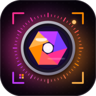

<div align="center">



# uzI Camera Pro

**A fast, modern, full-screen camera app for Android — built with Kotlin, Jetpack Compose & CameraX.**

[](https://developer.android.com)
[](https://kotlinlang.org)
[](https://developer.android.com/jetpack/compose)
[](https://developer.android.com/media/camera/camerax)
[](#-requirements)
[](https://github.com/Uzair-Nawaz/uzIcameraPro/releases)

[**Download APK**](https://github.com/Uzair-Nawaz/uzIcameraPro/releases/latest) · [**Report a Bug**](https://github.com/Uzair-Nawaz/uzIcameraPro/issues) · [**Request a Feature**](https://github.com/Uzair-Nawaz/uzIcameraPro/issues)

</div>

---

## 📖 Table of Contents

| # | Section |
|---|---------|
| 1 | [About](#-about) |
| 2 | [Features](#-features) |
| 3 | [Screenshots / Demo](#-screenshots--demo) |
| 4 | [Tech Stack](#-tech-stack) |
| 5 | [Languages & Libraries](#-languages--libraries) |
| 6 | [Project Structure](#-project-structure) |
| 7 | [Requirements](#-requirements) |
| 8 | [Getting Started](#-getting-started) |
| 9 | [Building & Releasing](#-building--releasing) |
| 10 | [Permissions](#-permissions) |
| 11 | [Roadmap](#-roadmap) |
| 12 | [License & Author](#-license--author) |

---

## 🚀 About

**uzI Camera Pro** is a lightweight, privacy-friendly camera application that puts a clean, edge-to-edge capture experience in your pocket. It uses Google's modern **CameraX** API for reliable hardware support and **Jetpack Compose** for a fully declarative, buttery-smooth UI.

- 🎯 **Zero ads, zero trackers** — just a camera that works.
- 🌗 **Full-screen preview** with smart overlays.
- 🎨 **Material 3** design, designed to feel native on every device.

---

## ✨ Features

### 📸 Capture
- **Photo mode** — high-speed captures with minimum shutter latency.
- **Video mode** — records with audio to the system gallery.
- **Front / Back camera** switching with a single tap.
- **Auto exposure boost** for the front camera (brighter selfies).

### ⚡ Flash & Lighting
- **Flash modes**: `AUTO` → `ON` → `OFF`, cycled from the top bar.
- Real **torch blink** on `AUTO` photos and a steady torch during `ON` video.

### 🔍 Controls
- **Pinch-to-zoom** with a live zoom badge; tap the badge to reset.
- **Live recording timer** while capturing video.
- **Photo / Video mode selector**.

### 🖼️ Gallery
- **In-app gallery** overlay with paging.
- **Share** and **delete** media directly from the app.
- Automatic jump to the **latest** captured media.

### 🔐 Privacy & UX
- **Runtime permission gate** with a friendly rationale screen.
- Saves to **MediaStore** — no private folders.
- **Edge-to-edge**, portrait-locked, and keeps the screen on.

---

## 🖼️ Screenshots / Demo

> Add your screenshots here — drop files into a `docs/` folder and reference them below.

```text
docs/screenshot_camera.png    → Camera preview + controls
docs/screenshot_video.png     → Recording with live timer
docs/screenshot_gallery.png   → In-app gallery
```

---

## 🧰 Tech Stack

| Category | Technology |
|----------|------------|
| **Language** | Kotlin |
| **UI Toolkit** | Jetpack Compose + Material 3 |
| **Camera Engine** | AndroidX CameraX |
| **Architecture** | MVVM (ViewModel + StateFlow) |
| **Async** | Kotlin Coroutines & Flow |
| **Storage** | Android `MediaStore` API |
| **Build System** | Gradle (Kotlin DSL) + Version Catalog |
| **Android Gradle Plugin** | 8.11.0 |

---

## 🧬 Languages & Libraries

### Language Breakdown

| Language | Usage | Share |
|----------|-------|:-----:|
| **Kotlin** | App logic, UI, camera controller | **100%** |
| XML | Android resources (manifest, themes, vectors) | — |
| Gradle KTS | Build configuration | — |

> 📊 `13` Kotlin source files · `~2,087` lines of Kotlin · `11` XML resource files.

### Core Dependencies

| Library | Version | Purpose |
|---------|:-------:|---------|
| `androidx.camera:camera-core` | 1.3.4 | CameraX core |
| `androidx.camera:camera-camera2` | 1.3.4 | Camera2 backend |
| `androidx.camera:camera-lifecycle` | 1.3.4 | Lifecycle-aware binding |
| `androidx.camera:camera-video` | 1.3.4 | Video recording |
| `androidx.camera:camera-view` | 1.3.4 | `PreviewView` |
| `androidx.camera:camera-extensions` | 1.3.4 | OEM effects/extensions |
| `androidx.compose.material3:material3` | 1.0.0 | Material 3 UI |
| `androidx.compose:compose-bom` | 2022.10.00 | Compose version alignment |
| `androidx.lifecycle:lifecycle-viewmodel-compose` | 2.6.2 | `viewModel()` in Compose |
| `org.jetbrains.kotlinx:kotlinx-coroutines-android` | 1.7.3 | Coroutines on Android |

---

## 📁 Project Structure

```text
uzI Camera Pro/
├── app/
│   ├── build.gradle.kts              # App module config, signing, dependencies
│   ├── proguard-rules.pro
│   └── src/main/
│       ├── AndroidManifest.xml        # Permissions, activity, features
│       ├── java/com/uzicamera/pro/
│       │   ├── MainActivity.kt         # Entry point + permission gate
│       │   ├── camera/
│       │   │   ├── CameraController.kt # CameraX binding & capture logic
│       │   │   ├── CameraViewModel.kt   # MVVM state holder
│       │   │   ├── CameraState.kt       # UI state + enums (mode, flash)
│       │   │   └── CameraUtils.kt       # Helpers (clamp, etc.)
│       │   ├── media/
│       │   │   └── MediaStoreManager.kt # Save/query media via MediaStore
│       │   └── ui/
│       │       ├── camera/
│       │       │   ├── CameraScreen.kt      # Root screen layout
│       │       │   ├── CameraPreview.kt     # PreviewView wrapper
│       │       │   └── CameraControls.kt    # Top/bottom/mode controls
│       │       ├── gallery/
│       │       │   └── GalleryScreen.kt     # In-app gallery + share/delete
│       │       └── theme/                    # Color, Theme, Type
│       └── res/                        # Icons, strings, themes, XML
├── gradle/
│   ├── libs.versions.toml             # Version catalog
│   └── wrapper/                       # Gradle wrapper
├── build.gradle.kts
├── settings.gradle.kts
├── gradle.properties
├── gradlew
├── release.keystore                   # ⚠️ git-ignored (local only)
└── release.properties                 # ⚠️ git-ignored (local only)
```

---

## ✅ Requirements

| Tool | Minimum |
|------|---------|
| Android version | **8.0 (Oreo)** / API 26 |
| Target SDK | API 36 |
| JDK | 17 |
| Android Gradle Plugin | 8.11.0 |
| Kotlin | 1.9.22 |
| Gradle | Wrapper included |

---

## 🛠️ Getting Started

### 1. Clone

```bash
git clone https://github.com/Uzair-Nawaz/uzIcameraPro.git
cd uzIcameraPro
```

### 2. Build a debug APK

```bash
./gradlew assembleDebug
```

The APK appears at:

```text
app/build/outputs/apk/debug/app-debug.apk
```

### 3. Install on a device

```bash
adb install -r app/build/outputs/apk/debug/app-debug.apk
```

> Or open the project in **Android Studio** and hit ▶️.

---

## 📦 Building & Releasing

Release builds are **automatically signed** when a `release.properties` file exists at the project root:

```properties
storePassword=********
keyAlias=********
keyPassword=********
storeFile=release.keystore
```

Build the signed release:

```bash
./gradlew assembleRelease
```

> 🔒 `release.keystore` and `release.properties` are **excluded via `.gitignore`** — never commit your signing keys.

### Publishing a GitHub Release

```bash
gh release create v1.0 app/build/outputs/apk/release/app-release.apk \
  --title "uzI Camera Pro v1.0" \
  --notes "First release"
```

---

## 🔑 Permissions

| Permission | Why | When |
|------------|-----|------|
| `CAMERA` | Capture photos & video | Always |
| `RECORD_AUDIO` | Audio in videos | Always |
| `WRITE_EXTERNAL_STORAGE` | Save media | API ≤ 28 |
| `READ_EXTERNAL_STORAGE` | Gallery access | API 29 – 32 |
| `READ_MEDIA_IMAGES` / `READ_MEDIA_VIDEO` | Gallery access | API 33+ |

---

## 🗺️ Roadmap

- [x] Photo & video capture
- [x] Front/back camera + flash modes
- [x] Pinch-to-zoom
- [x] In-app gallery (share/delete)
- [ ] Grid lines & level indicator
- [ ] Timer / countdown capture
- [ ] Tap-to-focus
- [ ] Pro mode (ISO / shutter / focus)
- [ ] Full-resolution & RAW output

---

## 📜 License & Author

<div align="center">

**Made with ❤️ by [Uzair Nawaz](https://github.com/Uzair-Nawaz)**

📧 [sardaruzairnawazkhan1762@gmail.com](mailto:sardaruzairnawazkhan1762@gmail.com)

⭐ If you like this project, consider giving it a **star**!

</div>

---

<div align="center">
<sub>© 2026 Uzair Nawaz · uzI Camera Pro</sub>
</div>
